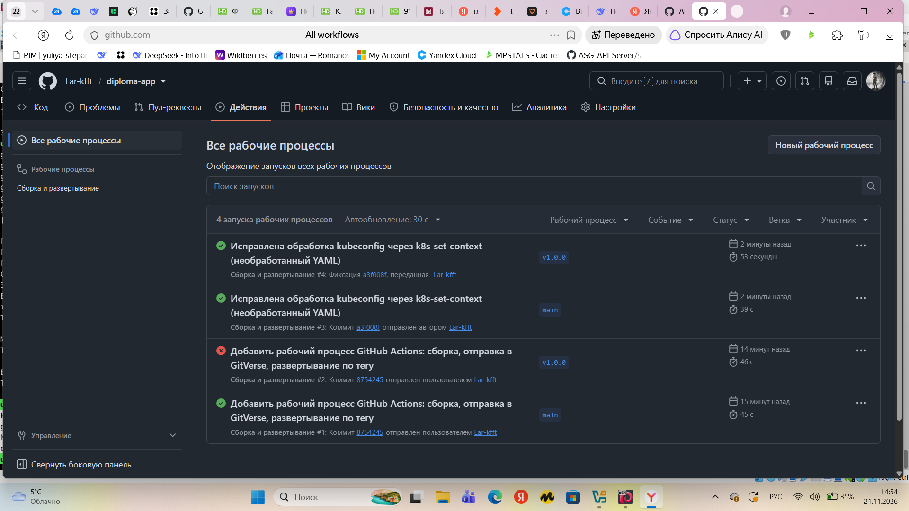
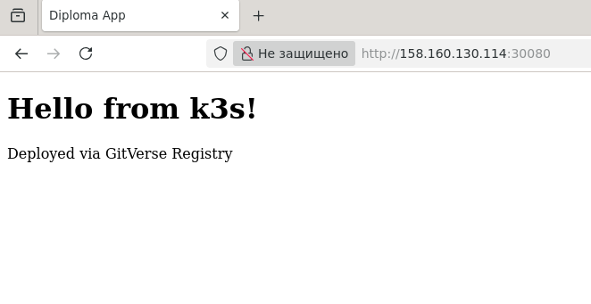
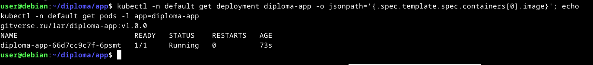

# diploma-app

Тестовое статическое приложение (nginx) для дипломного проекта: Dockerfile, манифест деплоя, CI/CD через GitHub Actions.

## Состав

- Dockerfile — образ на базе nginx:alpine со статической страницей.
- index.html — тестовая страница.
- deployment.yaml — Deployment + Service (NodePort 30080).
- .github/workflows/ci-cd.yml — GitHub Actions: сборка образа, пуш в GitVerse Registry, деплой в k3s по тегу v*.

## CI/CD

- На push в main: сборка и пуш образа с тегами :<sha> и :latest.
- На тег v*: сборка и пуш с тегом v1.0.0, затем kubectl set image в кластере и rollout status.

Секреты репозитория: GITVERSE_USERNAME, GITVERSE_TOKEN, KUBE_CONFIG.

### Успешный прогон по тегу

## Деплой

kubectl apply -f deployment.yaml

Приложение: http://153.51.175.14:30080

Образ в кластере после деплоя по тегу: gitverse.ru/lar/diploma-app:v1.0.0

## Особенности (РФ)

- Образы хранятся в GitVerse Registry (gitverse.ru/lar/diploma-app), а не в Docker Hub / Yandex Container Registry.
- CI/CD — GitHub Actions, деплой через azure/k8s-set-context с сырым kubeconfig из секрета.
- Для сборки на GitHub Actions базовый образ nginx:alpine тянется с Docker Hub (доступен на раннере).
